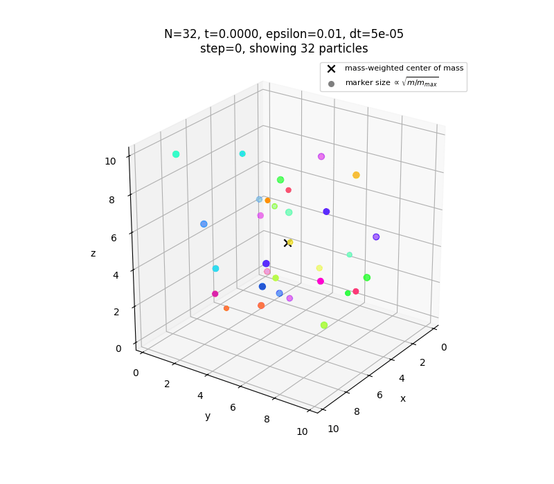
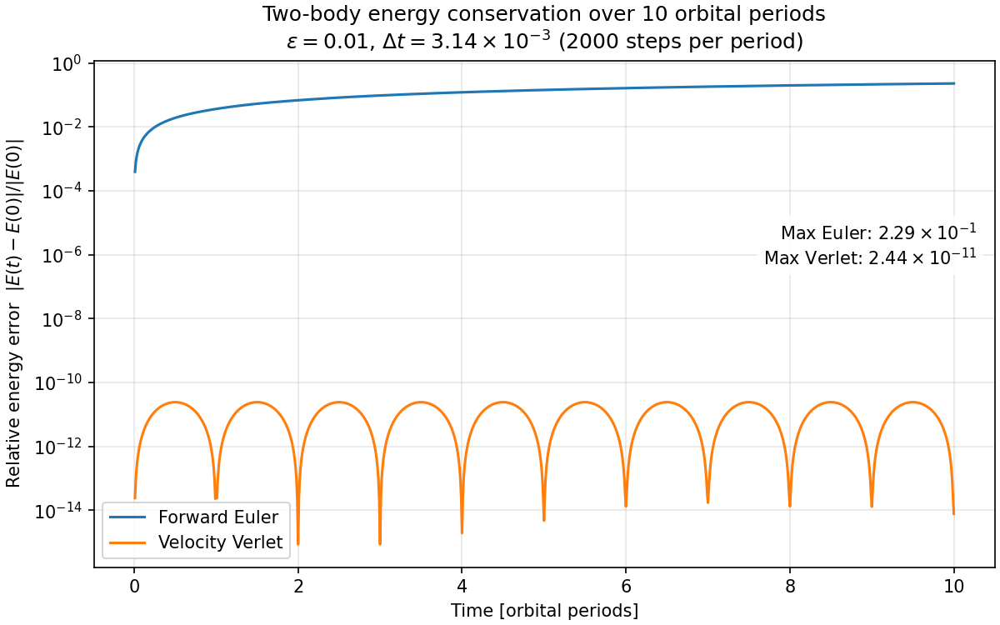
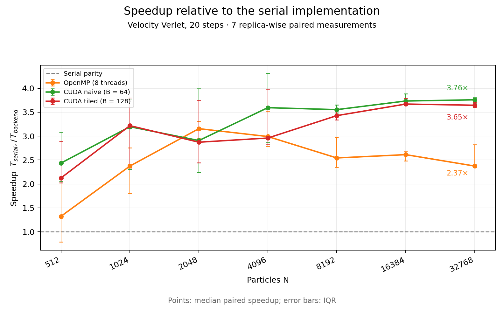

# N-Body Simulation: Serial, OpenMP and CUDA

Numerical implementation of the three-dimensional gravitational N-body problem, developed for the **Modern Computing for Physics** course in the MSc in Physics of Data at the University of Padua.

The project compares a serial CPU implementation with OpenMP, OpenMP with SIMD directives, and two CUDA kernels. It includes numerical validation, performance benchmarks, and the main results used in the final presentation.

<p align="center">
  
</p>

## Implementations

- **Serial CPU** baseline in C++
- **OpenMP** and **OpenMP + SIMD** CPU versions
- **CUDA naive** kernel using global memory
- **CUDA tiled** kernel using shared memory
- **Euler** and **Velocity Verlet** integration schemes
- Two-body and random initial conditions, with configurable time step and gravitational softening

The direct force evaluation scales as `O(N²)`. Velocity Verlet was used for the main experiments because it provides much better long-term energy conservation than Euler.

## Main results

The implementations were checked against the serial reference using deterministic initial conditions. The repository includes the final validation tables, benchmark summaries, raw timing data, and metadata needed to interpret the measurements.

<p align="center">
  
  
</p>

Benchmarks were collected on an Intel Core i7-10510U CPU and an NVIDIA GeForce MX250 GPU. Results depend on the hardware and software environment, so the included measurements should be read as a comparison on that system rather than as general performance claims.

## Build and run

The CPU versions require a C++17 compiler with OpenMP support:

```bash
make
```

Build the CUDA implementations separately when the CUDA toolkit is available:

```bash
make cuda-naive
make cuda-tiled
```

Example serial run:

```bash
./bin/nbody_serial \
  --N 32 \
  --steps 1000 \
  --dt 0.001 \
  --epsilon 0.01 \
  --init random \
  --integrator verlet \
  --save-every 10 \
  --output trajectory.csv \
  --energy-output energy.csv
```

Install the Python packages used by the analysis and plotting scripts with:

```bash
python3 -m pip install -r requirements.txt
```

The scripts in `scripts/` reproduce the validation studies, benchmarks, figures, and animations. Some benchmark scripts require the corresponding CPU or CUDA executable to be built first.

## Repository contents

- `src/` and `include/`: C++ and CUDA implementations
- `scripts/`: validation, benchmarking, plotting, and animation scripts
- `results/`: selected final CSV summaries, raw measurements, and benchmark metadata
- `figures/`: selected validation and performance plots
- `animations/`: example N-body evolution
- `presentation/nbody_simulation.pdf`: [final project presentation](presentation/nbody_simulation.pdf)

Large trajectory files, intermediate experiments, compiled binaries, and profiler traces are intentionally excluded. They can be regenerated from the source code and scripts.

